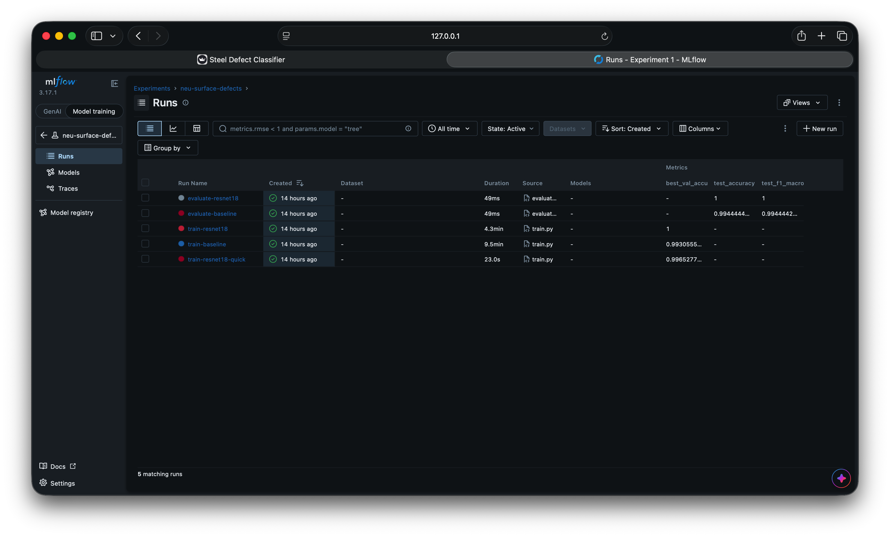
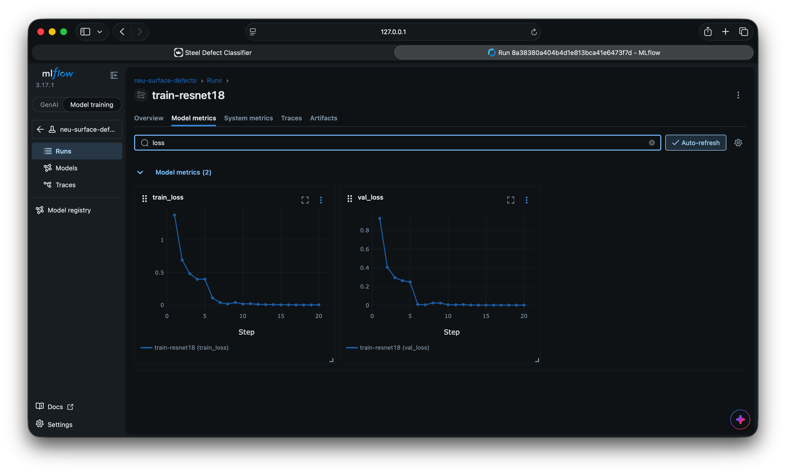

# Steel Surface Defect Classifier (NEU)

An end-to-end computer-vision prototype that classifies steel-surface images into six defect types. It covers a reproducible training pipeline, experiment tracking with MLflow, data and pipeline versioning with DVC, and a Streamlit app.

> **Live demo:** https://neu-steel-defects.streamlit.app  ·  **Demo video:** https://drive.google.com/file/d/100_kvX8dhHJMidZwUba859rLN75GgEt6/view?usp=sharing

| | |
|---|---|
| Task | 6-class image classification: crazing, inclusion, patches, pitted_surface, rolled-in_scale, scratches |
| Models | Small CNN from scratch (baseline) vs. ImageNet-pretrained **ResNet18** (fine-tuned) |
| Stack | PyTorch · torchvision · MLflow · DVC · Streamlit · pytest |
| Result | **ResNet18: 100% test accuracy (360/360)**; baseline CNN 99.44% (358/360). See [reports/comparison.md](reports/comparison.md) |

---

## 1. Dataset

**Source:** [NEU Surface Defect Dataset on Kaggle](https://www.kaggle.com/datasets/bobweng/neu-surface-defect-dataset) (the "NEU-DET" version).
It contains 1,800 grayscale images, 200×200 px, 300 per class. They are stored as 3-channel JPEGs with identical channels.

Folder structure after unzipping (checked before training):
```
NEU-DET/
  train/images/<class>/*.jpg        240 per class
  train/annotations/*.xml           bounding boxes (not used: this is a classification task)
  validation/images/<class>/*.jpg   60 per class
  validation/annotations/*.xml
```

### Split policy (`src/data.py`)
| Our split | Taken from | Size | Used for |
|---|---|---|---|
| **train** | Kaggle `train/`, 80% stratified | 1,152 (192/class) | fitting weights |
| **val** | Kaggle `train/`, 20% stratified | 288 (48/class) | early stopping, choosing the model, temperature calibration |
| **test** | Kaggle `validation/` | 360 (60/class) | **final score only**, never used for any decision |

* The split is seeded (`seed: 42` in `params.yaml`) and stratified, so every class has the same share in each split.
* **Leakage checks:** every image is hashed (MD5). Byte-identical images are kept in the same split, and any training image identical to a test image is dropped. The dataset has one exact duplicate pair (`patches_101.jpg` = `patches_105.jpg`), and both stay in the same split. No train/test duplicates were found. Details are in `reports/data_report.json`.

### Preprocessing (`src/transforms.py`, saved per model in `models/<model>/preprocess.json`)
1. Convert to 3-channel RGB (grayscale is repeated; RGBA, palette and 16-bit images are handled).
2. Resize to 224×224.
3. Normalise with ImageNet mean/std (required by the pretrained ResNet18; used for both models so the comparison is fair).

**Training-only augmentation:** horizontal and vertical flips, ±10° rotation with 5% shift, and ±20% brightness/contrast. A mirrored scratch is still a scratch, and line lighting varies. There is no colour jitter (the images are grayscale) and no aggressive crops (a crop could cut the defect out).

The app, evaluation and CLI all build the eval transform from the saved `preprocess.json`, which avoids train/serve skew.

---

## 2. Models and training

| | Baseline CNN | ResNet18 |
|---|---|---|
| Idea | How hard is the task with **no** prior knowledge? | How much does **transfer learning** add? |
| Architecture | 4 × [conv-BN-ReLU ×2 + max-pool] (32→256 ch) → GAP → dropout → linear | ImageNet ResNet18, new head: dropout → linear(512→6) |
| Parameters | ~1.2 M | ~11.2 M |
| Training | AdamW, lr 1e-3, cosine schedule, up to 30 epochs | Stage 1: backbone frozen, head only (5 ep, lr 1e-3). Stage 2: everything unfrozen (up to 15 ep, lr 1e-4) |
| Shared | batch 32 · cross-entropy · weight decay 1e-4 · early stopping (patience 5 on val loss) · best-val-loss checkpoint |

**Why two stages for ResNet18?** A new, random head produces large gradients. If the backbone is unfrozen from the start, those gradients can wreck the pretrained features. Training the head first and then fine-tuning everything with a 10× smaller learning rate keeps those features and adapts them to steel textures.

**Model selection** uses **validation** macro-F1 only (`src/compare.py`). Test numbers are reported but never used to choose.

### Confidence calibration (optional step, `src/calibrate.py`)
A confidence of 95% is only useful if the model is right about 95% of the time at that confidence. We fit **temperature scaling** (one scalar *T* that divides the logits) on the **validation** set and report the Expected Calibration Error (ECE) before and after on test. *T* never changes the predicted class, so accuracy is identical. If the model makes **zero** validation errors, *T* cannot be fitted meaningfully, so it stays at 1.0 and the reason is logged.

### Explainability
The app shows a **Grad-CAM** heatmap (`src/gradcam.py`, about 40 lines, no extra library) of the image regions that drove the prediction.

---

## 3. Results

| Metric (test, n = 360) | Baseline CNN | ResNet18 |
|---|---|---|
| Accuracy | 99.44% (2 errors) | **100.00%** (0 errors) |
| Macro precision | 99.45% | 100.00% |
| Macro recall | 99.44% | 100.00% |
| Macro F1 | 99.44% | 100.00% |
| ECE (uncalibrated → calibrated) | 0.0205 → 0.0045 | 0.0016 (T = 1, not fitted) |
| CPU latency (ms/image) | 11.7 | 7.8 |
| Model size (MB) | 4.7 | 44.8 |
| Training time (s) | 567 | 258 |

**Selected: ResNet18**, chosen on validation macro-F1 (100% vs 99.31%), never on test.

Key findings:
* NEU is an easy dataset, so even the from-scratch CNN reaches 99.4%. Transfer learning mainly bought **faster, more stable training** and robustness on the hardest class.
* Both baseline errors involve **inclusion**, and ResNet18's least confident correct predictions are mostly inclusions. **Inclusion vs scratches** (both thin vertical streaks) is the weak spot.
* 0 errors in 360 means the true error rate is very likely below ~0.8% (rule of three), not exactly 0.

Per-model figures are in `reports/<model>/`: `confusion_matrix.png`, `misclassified.png`, `least_confident_correct.png`, `training_curves.png`, `metrics.json`.

**Error analysis, limitations and next steps:** see [docs/technical_notes.md](docs/technical_notes.md).

---

## 4. Setup

Tested with **Python 3.13.3** on macOS (Apple Silicon). Python 3.10 or newer should work.

```bash
git clone <this repo> && cd neu-steel-defect-classifier
python3 -m venv .venv && source .venv/bin/activate
pip install -r requirements-dev.txt
# or, for the exact versions used for the reported results:
# pip install -r requirements-lock.txt
```

### Get the data
Download the dataset from Kaggle (link above) and unzip it into `data/raw/`:
```bash
unzip "path/to/archive.zip" -d data/raw/      # creates data/raw/NEU-DET/
```
> **Note on `dvc pull`:** the DVC remote used for this project is a folder on my laptop (`~/dvc-storage`), so `dvc pull` will not work on another machine. Please download the data from Kaggle as shown above. `data/raw/NEU-DET.dvc` still records the exact hash of the dataset (3,600 files), so you can check that your copy matches with `dvc status`.

---

## 5. Reproduce training and evaluation

**One command (DVC pipeline):**
```bash
dvc repro          # prepare -> train (x2) -> calibrate (x2) -> evaluate (x2) -> compare
dvc dag            # shows the pipeline graph (below)
dvc metrics show   # prints test metrics for both models
```

Pipeline graph (`dvc.yaml`):
```
            prepare  (data/raw/NEU-DET -> data/splits)
           /                \
  train@baseline        train@resnet18
        |                     |
calibrate@baseline    calibrate@resnet18
        |                     |
evaluate@baseline     evaluate@resnet18
           \                /
              compare  (reports/comparison.md)
```

**Or step by step:**
```bash
python -m src.prepare_data                  # writes data/splits/*.csv + reports/data_report.json
python -m src.train --model baseline
python -m src.train --model resnet18
python -m src.calibrate --model baseline
python -m src.calibrate --model resnet18
python -m src.evaluate --model baseline     # test set, used once per final model
python -m src.evaluate --model resnet18
python -m src.compare                       # writes reports/comparison.md
```
Add `--quick` to `train` for a 1–2 epoch smoke test.

**Experiment tracking:**
```bash
mlflow ui --backend-store-uri sqlite:///mlflow.db     # open http://127.0.0.1:5000
```
Screenshots of the MLflow runs (the `mlruns/` folder and `mlflow.db` are not in Git):




Each training run logs its parameters, per-epoch train/val loss and accuracy, best-val metrics, the data version (hash of the split files), the git commit, the device, and the model files. Each evaluation run logs test metrics (overall and per class) and all figures.

**Reproducibility:** all settings live in `params.yaml`. Seeds are fixed for Python, NumPy and PyTorch (including the DataLoader shuffle). Exact package versions are in `requirements-lock.txt`. On a GPU or Apple MPS a few operations are non-deterministic, so re-runs can differ slightly in the last decimals. The data split is always identical.

---

## 6. Run the app

```bash
streamlit run app.py
```
Upload an image or pick a sample from `samples/` (one test image per class). The app:
- validates the file: type, empty, corrupt, renamed non-image, too small, too large, real format vs. extension
- **warns** (but still predicts) for colour photos, flat images and very non-square images, which look nothing like the training data
- shows the predicted class, its confidence, all six class probabilities, a low-confidence warning (threshold adjustable) and a Grad-CAM heatmap

Command-line prediction:
```bash
python -m src.predict samples/scratches_241.jpg
```

---

## 7. Tests

```bash
pytest
```
| File | What it checks |
|---|---|
| `tests/test_validation.py` | Good images are accepted. Bad files (wrong type, empty, corrupt, renamed, tiny, oversized, GIF disguised as PNG) are rejected with clear messages. Colour/flat images trigger warnings. RGBA and 16-bit inputs are handled. |
| `tests/test_data_split.py` | The split is stratified, disjoint, reproducible by seed, keeps duplicates together and drops train copies of test images |
| `tests/test_metrics_calibration.py` | Softmax, ECE, metrics, and that temperature scaling fixes an over-confident model |
| `tests/test_model_and_predict.py` | Preprocessing shape and determinism, any input mode → 3 channels, model output shapes, Predictor output format, temperature behaviour, Grad-CAM, a helpful error when the model is missing, and the trained model on the samples |

---

## 8. Data and model versioning (DVC)

```bash
dvc init
dvc add data/raw/NEU-DET                       # data is hashed; Git stores only the small .dvc pointer
dvc remote add -d localstore ~/dvc-storage     # any folder, S3, GDrive...
dvc push
```
`dvc.yaml` defines the pipeline, and `dvc.lock` records the exact hash of every input and output, so any result can be traced to the data, code and params that produced it.

**Remote:** the configured remote (`localstore`) is a local folder on my laptop. That is enough to show versioning and `dvc push`, but reviewers cannot `dvc pull` from it, so the README points to Kaggle for the data. For a team, the remote would be S3, GCS or Google Drive.

**Trade-off we chose:** the **dataset** is cached by DVC (not in Git). The **trained model files** (`cache: false`) stay in Git because they are small (about 45 MB for ResNet18) and the Streamlit Cloud app must load them directly; Streamlit Cloud cannot run `dvc pull`. DVC still hashes them in `dvc.lock`. With a larger model we would store it in a cloud DVC remote or a model registry, and download it at app start-up.

---

## 9. Project structure
```
├── app.py                  Streamlit app
├── params.yaml             all settings (seed, split, preprocessing, training, app)
├── dvc.yaml / dvc.lock     pipeline definition / exact versions
├── requirements*.txt       runtime deps / dev deps / exact lock (requirements-lock.txt)
├── src/
│   ├── data.py             dataset scan, hashing, stratified split
│   ├── prepare_data.py     step 1: write split CSVs
│   ├── transforms.py       preprocessing + augmentation
│   ├── dataset.py          PyTorch Dataset
│   ├── models.py           baseline CNN + ResNet18
│   ├── train.py            training loop + MLflow logging
│   ├── calibrate.py        temperature scaling on val
│   ├── evaluate.py         test metrics, confusion matrix, error analysis
│   ├── compare.py          side-by-side comparison, model choice
│   ├── predict.py          Predictor class (used by app, eval, CLI)
│   ├── gradcam.py          Grad-CAM
│   ├── validation.py       upload checks
│   └── metrics.py          metrics + ECE
├── models/<model>/         model.pt, preprocess.json, calibration.json, train_summary.json
├── reports/                metrics, plots, comparison
├── samples/                one test image per class for the app
├── tests/
└── docs/                   technical notes, AI prompt log, screenshots
```

---

## 10. Use of AI tools
AI assistance was used for planning, code and documentation. Every module was reviewed, run and tested. The prompts and how the outputs were validated are listed in [docs/prompts_used.md](docs/prompts_used.md).

## 11. Citation
Dataset: K. Song and Y. Yan, "A noise robust method based on completed local binary patterns for hot-rolled steel strip surface defects", *Applied Surface Science*, 285, 858–864, 2013. NEU-DET version: Y. He, K. Song, Q. Meng, Y. Yan, "An End-to-end Steel Surface Defect Detection Approach via Fusing Multiple Hierarchical Features", *IEEE Transactions on Instrumentation and Measurement*, 2020. Kaggle mirror by bobweng.
ResNet: K. He et al., "Deep Residual Learning for Image Recognition", CVPR 2016. Grad-CAM: R. Selvaraju et al., ICCV 2017. Temperature scaling: C. Guo et al., "On Calibration of Modern Neural Networks", ICML 2017.
